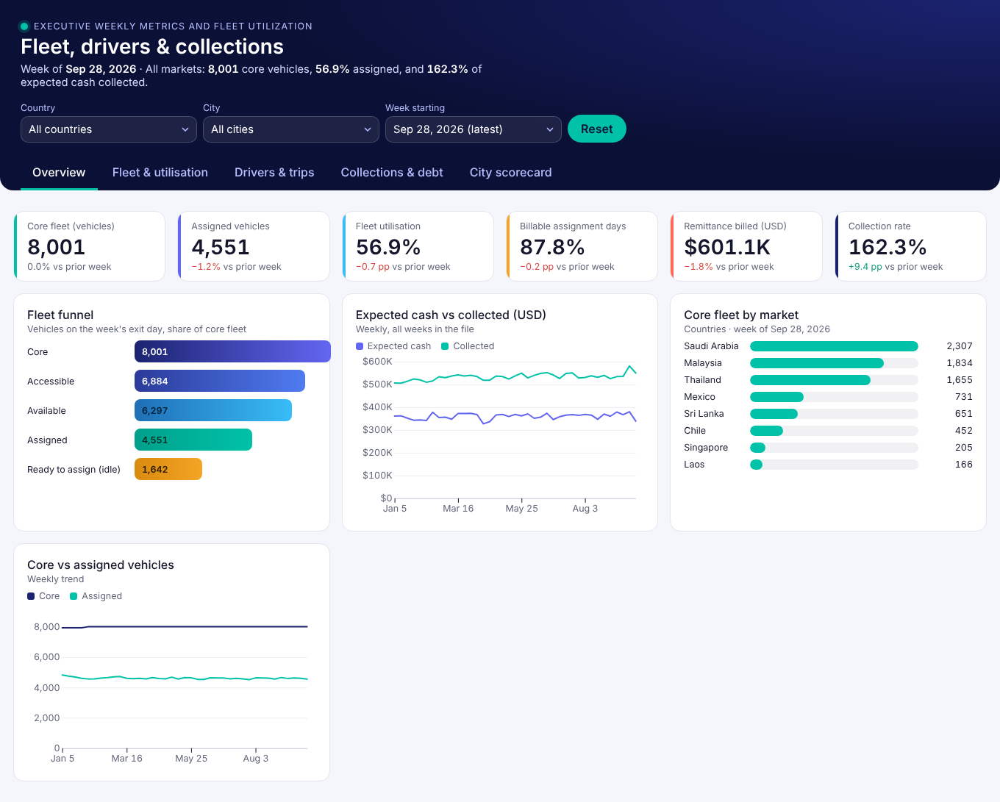
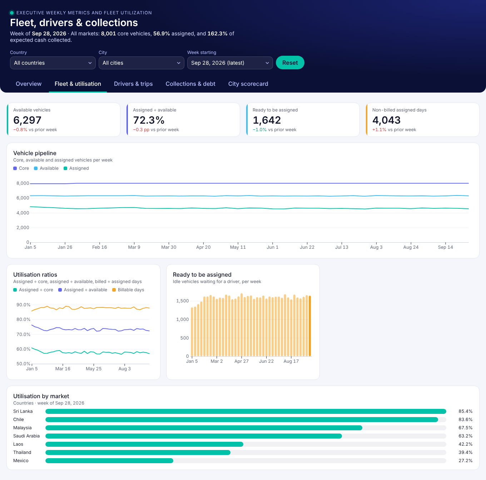
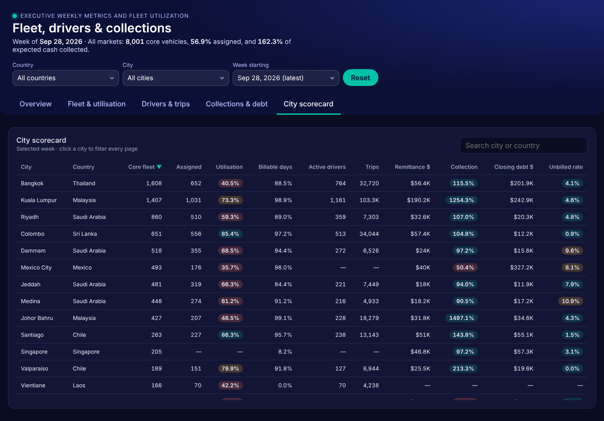

# Executive Weekly Metrics and Fleet Utilization

An interactive executive dashboard for a multi-market vehicle-financing / driver-fleet business. It tracks **fleet utilisation, driver activity and cash collections** week by week across 8 countries and 19 cities.

I built it end to end with **Claude (Cowork)**, starting from a raw Excel export of a weekly dbt aggregation model. Claude wrote the code and I directed the design. It is published here as a static site that runs anywhere, including GitHub Pages.

> **Live demo:** `https://<your-github-username>.github.io/Claude-Executive-Dashboard/`
> **Data:** all figures are **dummy data** created for demonstration. They are not real business numbers.



---

## Highlights

- **5 pages (tabs):** Overview · Fleet & utilisation · Drivers & trips · Collections & debt · City scorecard.
- **Global filters:** Country → City (the city list depends on the country), Week (defaults to the latest week), and Reset.
- **Change vs prior week** on every KPI. Rates show the change in percentage points, and counts and money show the change in percent. Green or red depends on whether the change is good for that metric.
- **Correct rollups.** Ratios are recalculated from summed numerators and denominators at each level (all markets, country, city). Averaging city percentages would give the wrong answer.
- **Multi-currency safe.** All money uses the USD-converted columns, so countries add up.
- **City scorecard** that you can sort and search, with RAG-coloured rates. Clicking a city filters the whole dashboard.
- **Interactive charts** (d3 v7): hover tooltips, a fleet funnel and market breakdowns.
- **Responsive.** Works side by side at ~400 px and full screen, in light or dark mode.
- **Data-driven filters.** New countries and cities appear in the filters automatically when the data file changes, with no code edits.

| Fleet & utilisation | City scorecard (dark mode) |
|---|---|
|  |  |

---

## Metrics

| KPI | Definition |
|---|---|
| Core fleet | Vehicles in the core fleet on the week's exit day |
| Fleet utilisation | Assigned vehicles ÷ core vehicles |
| Assigned ÷ available | Assigned vehicles ÷ available vehicles |
| Billable assignment days | Total billed days ÷ total assigned days |
| Ready to be assigned | Idle vehicles waiting for a driver |
| Trips per supply hour | Total trips ÷ supply hours |
| Supply hours per active driver | Supply hours ÷ active drivers |
| Unbilled driver rate (14d) | Drivers billed 21–14 days ago who were unbilled in the last 14 days ÷ drivers billed 21–14 days ago |
| Collection rate | Driver payments (USD) ÷ expected cash (USD) |
| Closing debt | Outstanding driver debt at the end of the weekly cycle (USD) |

Trip, supply-hour and active-driver metrics are only reported for some cities, so those ratios are computed over the reporting cities only.

---

## How it was built (step by step)

1. **Source data.** I started from an Excel export of a weekly, city-level dbt aggregation model: 90 columns at `week_start × country × city` grain, covering fleet, assignment, trips, billing and driver-ledger (remittance, payments, debt) metrics.
2. **Profiling with Claude.** Claude read the workbook and found the grain (one row per city per week). It also found which metric groups are sparse, for example trip data that only some cities report.
3. **Column selection.** I kept 31 of the 90 columns: fleet funnel, billing, driver/trip activity and **USD-only** finance columns. Local-currency columns were dropped so totals stay comparable across markets. See [`scripts/xlsx_to_json.py`](scripts/xlsx_to_json.py).
4. **Dashboard spec.** I asked for a professional dashboard with filters and navigation, using a navy and teal mobility-fintech palette.
5. **Data model in the dashboard:**
   - `weekly`: the raw city-week rows (JSON).
   - `agg` (calculation): sums every metric for each week at three levels (all markets, each country, each city), then derives the ratios from those sums. This plays the same role as `GROUPING SETS` in SQL.
   - `wow` (calculation): joins each row to the same market's prior week and returns relative (%) or point (pp) changes.
6. **UI.** I wrote one HTML page with scoped CSS and d3 v7 charts: KPI tiles, line and bar trends, a funnel, horizontal market bars, and a sortable, searchable table. Filters and tabs are plain DOM controls bound to dashboard parameters.
7. **Data source swap.** I replaced the dataset with a new file that has new countries and cities and 39 weeks. No layout changes were needed, because the filter options, week list and breakdowns are all derived from the data.
8. **Branding.** I renamed the dashboard to *Executive Weekly Metrics and Fleet Utilization* and removed the earlier internal naming.
9. **Export for GitHub.** The dashboard originally ran as a Claude Dashboard artifact. For this repo, the same page runs on a ~75-line runtime ([`assets/dash-runtime.js`](assets/dash-runtime.js)) that provides the small `dash` API it uses (`data`, `calc`, `onData`, `params`, `setParams`). A token stylesheet ([`assets/theme.css`](assets/theme.css)) supplies the theme.

---

## Project structure

```
Claude-Executive-Dashboard/
├── index.html                  # Standalone site (page + runtime + d3 from CDN)
├── assets/
│   ├── dash-runtime.js         # Minimal stand-in for the Claude Dashboard runtime
│   └── theme.css               # Design tokens (light + dark)
├── data/
│   └── executive_weekly_metrics.json   # 741 rows · 39 weeks · 19 cities (dummy)
├── artifact/                   # Original Claude Dashboard artifact source
│   ├── index.html              # The page exactly as authored in the artifact
│   ├── dataset_weekly.json     # Dataset definition
│   ├── meta.json · params.json # Title and filter defaults
├── scripts/
│   └── xlsx_to_json.py         # Excel → JSON conversion
└── docs/                       # Screenshots
```

---

## Run locally

The page loads its data with `fetch`, so serve the folder instead of double-clicking the file:

```bash
git clone https://github.com/<your-github-username>/Claude-Executive-Dashboard.git
cd Claude-Executive-Dashboard
python -m http.server 8000
# open http://localhost:8000
```

### Refresh the data

```bash
pip install openpyxl
python scripts/xlsx_to_json.py "path/to/your_export.xlsx" data/executive_weekly_metrics.json
```

The Excel file needs the same column names. Countries, cities and weeks update automatically.

---

## Tech

`HTML` · `CSS` · `JavaScript` · `d3.js v7` · `Python (openpyxl)` · built with **Claude (Cowork)**. The data comes from a `dbt` + `Amazon Redshift` weekly mart.

## Author

**Unnish**, Data Analytics & BI (dbt · Redshift · Power BI · Tableau · SQL)

## License

MIT. See [LICENSE](LICENSE).
